# FASE 4 · ETAPA 2 — Relatório (recursos de chapa 3D)

Branch `feature/agtn-3d-ia` · base da etapa `e463834` · **main intocada (`23a2540`)** · nada publicado.

## 1. Resumo

Todas as entregas do plano aprovado foram concluídas, na ordem 2.0 → 2.6, cada uma com o seu commit e os seus
testes.

O critério de "concluído" foi o pedido: **conferência no núcleo geométrico e nos arquivos gerados**. Para cada
recurso, o teste confere:
- o grafo contra a fórmula;
- o sólido OCCT contra o grafo (volume 1e-9, superfícies pela proveniência, validade, interferência);
- a planificação contra o grafo;
- o DXF relido contra a planificação.

A interface só mostra o que o núcleo confirmou.

| Entrega | Commit | Situação |
|---|---|---|
| 2.0 proveniência por construção + ids estáveis | `9a42c31` | concluída |
| 2.1a faixa de dobra parcial (recuos) | `878f1b8` | concluída |
| 2.1b alívio de dobra (retangular, oblongo, lágrima) | `7e41587` | concluída |
| 2.2 aba de borda (posição do material, várias arestas, cantos detectados) | `b85ddc8` | concluída |
| 2.3 fechamento de canto (sobreposto, encosto, esquadria) | `8d025c6` | concluída; alívio de canto redondo **bloqueado** |
| 2.4 recortes que atravessam dobras | `3e02435` | concluída; círculo/arco/oblíquo dentro da faixa **bloqueados** |
| 2.5 desdobrar / redobrar | `ed3b4f1` | concluída, com a revisão matemática pedida |
| 2.6 DXF direto da planificação + validação | `d0d4225` | concluída; exportador 2D com bytes idênticos |
| persistência e desempenho | `21306bc`, `5ca8f73` | concluída |
| app compilado (Tauri Linux) | `5f3e0cd` | concluído; **Windows real: não executado** |

## 2. Arquitetura

Nenhum segundo motor. Todas as operações novas são passos do **mesmo grafo** da ETAPA 1:
- `modules/sheetmetal/src/sheet3d`: solver puro, sem OCCT;
- `modules/sheet3d`: ponte OCCT, construção e proveniência.

Fórmulas:
- só as do `bend.ts`, que **não foi alterado**: BA, OSB, ISB, BD;
- θ = deflexão e α = 180° − θ, só na interface.

```
operações (histórico) ─► solveSheet (grafo)
                          │  fase 1: topologia (abas, dobras, alívios, cantos, desdobrar/redobrar)
                          │  fase 2: geometria (faixas parciais, posição δ, lados de canto, posições G/H)
                          │  fim:    recortes na planificação (flatcut.ts) → fatias de faixa, entalhes
                          ▼
             SheetSolved ─┬─► buildSheet (OCCT: prismas, revoluções inteiras/parciais, prismas planos)
                          ├─► flatPattern (planificação: mesmo H, independente do estado dobrado)
                          └─► flatToDxf / validateFlatDxf (DXF da planificação, relido e conferido)
```

## 3. O que cada entrega faz

### 2.0 Proveniência por construção e ids estáveis
- Faces nomeadas **na construção**:
  - `extrudeWithHistory` / `revolveWithHistory` dão a origem das faces de cada aresta e do início/fim;
  - na fusão, `booleanOp` + `unifySameDomainWithHistory` repassam os nomes.
- A superfície de cada face é conferida contra o grafo. É só verificação: o nome nunca vem da posição.
- Ids estáveis:
  - segmentos de contorno `«op»#«segId»`;
  - linhas divididas `L3[«ponta»~«ponta»]`;
  - furos pela soma das entidades do esboço.
- Referência ambígua → erro explícito.

### 2.1a Recuos
- A faixa de dobra vai de `offsetStart` a `L − offsetEnd`.
- A região plana ganha **degraus** nas pontas.
- Faixa curta ou sobreposta → erro.

### 2.1b Alívio de dobra
Operação própria, que não é recorte.

| | Largura w | Profundidade d |
|---|---|---|
| Automático, retangular e lágrima | T + g | SB + g, que é R + T + g a 90° externa |
| Automático, oblongo | T + g | SB + g + w/2, para o fundo redondo passar da tangência |
| Lágrima: bulbo | raio w | — |

- A folga g vale 0,5 mm por padrão. É **editável** na operação e em Preferências, e não é tratada como norma.
- Muda T, R ou θ → o alívio é recalculado.
- Arcos exatos em todas as camadas: grafo, planificação, OCCT (cilindro) e DXF (bulge).
- Erros:

| Código | Quando |
|---|---|
| RELIEF_NOT_NEEDED | dobra sem ponta interna para aliviar |
| RELIEF_FIT | o alívio não cabe |
| RELIEF_DUP | dobra que já tem alívio |
| RELIEF_GAP / W / D | folga, largura ou profundidade fora da faixa |

- Correção encontrada: o raio de paridade de 1e9 criava cruzamento falso perto de arcos pequenos. Agora o raio é
  limitado à caixa do contorno, inclusive no teste de furos da ETAPA 1.

### 2.2 Aba de borda

| Posição do material | δ | Recuo da tangência da pai |
|---|---|---|
| material por dentro (padrão ETAPA 1) | 0 | SB |
| material por fora | T | SB − T |
| dobra por fora | SB | 0 (a dobra começa na aresta) |

- Recuo negativo: a pai cresce para fora (θ pequeno, com SB < T).
- A raiz da filha continua com o SB real.
- Arquivos sem `position` abrem como "dentro".
- **Cantos detectados** entre faixas vizinhas:
  - id `«a»+«b»`, vértice e ângulo interno;
  - mostrados no painel;
  - nada é aplicado em silêncio.

### 2.3 Fechamento de canto
- O lado de cada aba no canto é a **interseção com o plano da outra**:
  - plano × plano, exato para qualquer θ, R, T e ângulo do canto;
  - na fibra mais restritiva;
  - com corte normal à chapa.
- Regras, as mesmas da bandeja 2D validada:
  - **sobreposto**: a que fecha vai até a face externa da vizinha, menos g;
  - **encosto**: a que fecha vai até a face externa da vizinha; a outra, até a face interna da que fecha, menos g;
  - **esquadria**: plano bissetor, na fibra interna, com g/2 de cada lado.
- A folga é medida ao longo da aba, na mesma convenção da bandeja.
- A dobra fica do tamanho da faixa. O vazio entre as faixas é o **alívio de canto retangular**.
- Erros:

| Código | Quando |
|---|---|
| CORNER_GAP | folga negativa, ou encosto/esquadria com g = 0 (as abas se tocariam e virariam uma peça só) |
| CORNER_ROUND | alívio redondo (atravessa a dobra; sem aproximação) |
| CORNER_DUP | canto já tratado |
| CORNER_LOST | as abas não se encontram num canto |
| CORNER_SIDE | as abas dobram para lados opostos |
| CORNER_STRIP | o lado entraria na faixa de dobra |
| CORNER_IMPOSSIBLE | ângulos impossíveis para o canto |
| CORNER_ABA | uma das dobras não é aba de borda |

### 2.4 Recortes que atravessam dobras
- Operação **Recorte plano**: esboço no plano da base, que é o sistema da planificação.
- **Na faixa**, pela fibra neutra:
  - lados com u ou s constante → fatias [u0, u1] × [s0, s1];
  - no 3D, revolução **parcial** de φ0 = s0/(R + K·T) a φ1, exata;
  - faces novas `u:i` (plano normal ao eixo) e `s:j` (plano radial), conferidas no OCCT.
- **Na região plana**: o laço que entra pela tangência vira entalhe; inteiro dentro vira furo.
- Bloqueios, sem aproximação:

| Código | Quando |
|---|---|
| CUT_CIRCLE_BEND | círculo cruzando a faixa (decisão 3 da aprovação) |
| CUT2_ARC | arco dentro da faixa (oblongo: deixe os arcos nas regiões planas) |
| CUT2_OBLIQUE | lado oblíquo à dobra dentro da faixa |
| CUT2_EDGE | toca o contorno externo ou a ponta da faixa |
| CUT2_TOUCH | encosta na tangência sem atravessar |
| CUT2_SPLIT | dividiria a região |
| CUT_OVERLAP | toca outro furo |

### 2.5 Desdobrar / redobrar
Revisão matemática completa em [`FASE4_ETAPA2_DESDOBRAMENTO.md`](FASE4_ETAPA2_DESDOBRAMENTO.md).

- Ficam **separados**:
  - θ nominal (`deflectionDeg`, intacto);
  - θ efetivo (`effectiveDeg`);
  - BA do nominal (conservado);
  - estado (`folded`).
- Desdobrada:
  - a filha fica em `G_pai ∘ P` (a posição da planificação);
  - **não** se usa θ = 0 na fórmula da dobra, porque o `Trans(−BA·n)` recuaria a filha e a região some;
  - a região vira o prisma plano BA × L × T.
- Os cantos usam a posição nominal (`Gn`), então desdobrar não muda o canto.
- Redobrar recalcula do histórico: geometria nominal **exata**, sem acúmulo.

### 2.6 DXF direto da planificação
- Sai do **mesmo FlatPattern**, pelo `writeDxf` existente.
- **R2000 padrão**, com `$INSUNITS` = 4 (mm), escolhido em Preferências. R12 como opção.
- Escala 1:1, origem no canto do blank.
- Camadas:

| Camada | Conteúdo |
|---|---|
| `CUT_OUTER` | contorno externo |
| `CUT_INNER` | recortes e furos |
| `BEND_UP` / `BEND_DOWN` | linhas de dobra, por sentido |
| `BEND_MARK` | marcação D1…Dn |
| `BEND_REGION` | limites da região de dobra |
| `REFERENCE` | título e blank |

- Níveis de conteúdo: só corte; + dobras; + marcação; + regiões; + referência.
- As linhas de dobra ficam **só sobre material**: um recorte que atravessa a faixa as interrompe.
- `validateFlatDxf` **relê o arquivo** e confere:
  - leitura e unidades;
  - camadas;
  - um único contorno externo;
  - internos = recortes + furos;
  - todos os contornos fechados;
  - sem micro-segmentos (< 0,0001 mm) e sem duplicados;
  - área e comprimento de corte = grafo (1e-9);
  - caixa = blank;
  - dobras por sentido, sobre o material;
  - marcação.
- **Reprovado = não grava.**
- **Exportador 2D intocado:** `modules/dxf` não mudou desde `e463834`. Os hashes sha256 de R12, R2000 e da
  planificação da ETAPA 1 enviada ao DESENHO foram medidos **num worktree da base** e são iguais aos de agora.
  Há um teste que guarda esses hashes.

### Interface
- A faixa da Chapa ficou em grupos: **CHAPA** (Base, Aba de borda, Flange, Dobra), **RECURSOS** (Alívio,
  Canto, Recorte, Rec. plano) e **DOBRAR** (Desdobrar, Redobrar).
- Em PLANIFICAÇÃO entra o botão "DXF chapa".
- Novos diálogos: alívio, canto, desdobrar/redobrar e DXF (com o relatório da conferência). A aba de borda ganhou
  os campos de posição do material e de recuos.
- Painel Chapa: cantos detectados, com o tipo.
- "F" (enquadrar) passou a incluir a planificação exibida.
- O aviso "dobra sem alívio" some quando um Alívio posterior resolve. O aviso de K estimado continua.

### Correções de bugs encontrados durante a etapa (existiam antes)
1. **Furo poligonal anti-horário numa aba falhava no OCCT**. Existia desde a ETAPA 1: só furos circulares eram
   testados. O OCCT invertia a ordem das arestas e a proveniência recusava. Agora o laço interno é construído no
   sentido horário. Há um teste de regressão, e ele falha se a correção for desligada.
2. **Caixas de seleção ilegíveis no app compilado (WebKitGTK)**: saíam brancas e vazias no tema escuro, em todos
   os diálogos. Agora não usam a aparência nativa e têm seta própria. A conferência foi feita no `.deb` instalado.
3. Base de chapa: a linha "Para cima / Para baixo" estava rotulada "Material", repetindo o rótulo da linha de
   cima. Agora é "Lado da espessura".

## 4. Fórmulas e critérios

| Grandeza | Fórmula |
|---|---|
| BA, OSB, ISB, BD | `bend.ts` (inalterado) |
| Volume | V = Σ A·T + Σ θ·T·(R + T/2)·L |
| Faixa recortada | Σ Δu·Δs·T·(R + T/2)/(R + K·T) |
| Desdobrada | BA·L·T. Modelo do fator K: conserva a fibra neutra; ≠ θ·T·(R + T/2)·L, salvo com K = 0,5 |
| Área plana | Σ A + Σ BA·L (faixa recortada: Σ Δu·Δs) |
| Posição na faixa | φ = s/(R + K·T) |
| Tolerâncias | `tolerance.ts` (ETAPA 1), sem mudança |
| Conferências OCCT | volume 1e-9; espessura; ângulo medido = θ **efetivo**; caixa exata; interferência; nenhuma face sem origem; nenhuma face não-contato some na fusão |

## 5. Proveniência

O nome de cada face vem do histórico OCCT da construção. A superfície do grafo só confere.

| Rótulo | Face |
|---|---|
| `A`, `B` | faces da chapa |
| `e:«aresta»` | lado da região plana. Inclui degraus `k^n:p0/p1`, alívios `k^n:r0.i`, entalhes `«op»#«laço»:i` e trechos livres de canto `raiz:x0/x1` |
| `h:«furo»:i` | parede de furo |
| `int`, `ext`, `c0`, `c1`, `l0`, `l1` | faces da dobra |
| `u:i`, `s:j` | fatias de recorte na faixa |

Contato que pode sumir na fusão: c0/c1, raiz, faixas parciais `^`, degraus `>`, `u:i`.

## 6. Testes (resultados reais)

| Suíte | Resultado |
|---|---|
| `tsc` (todo o monorepo) | OK |
| Vitest (suíte completa) | **522/522**, 44 arquivos. Linha de base da etapa: 450 / 34 arquivos. Nenhum teste removido |
| `npm run validate:dxf` (ezdxf 1.4.5) | 14 arquivos, auditoria sem erro. Inclui 6 `chapa3d_*` (R2000 e R12) |
| e2e Chromium | `e2e3d` 34/34 · `e2e_param` 25/25 · `e2e_param2` 22/22 · `e2e_audit` 15/15 · `e2e_sheet` 18/18 · **`e2e_etapa2` 24/24** |
| Tauri Linux release (`.deb` 12,55 MiB, instalado com `dpkg`) | **`tauri_etapa2` 5/5** · `tauri_sheet` 3/3 · `tauri_param` 5/5 (995 MB RSS) · `tauri_compiled` 5/5 (917 MB RSS) |
| Windows real | **não executado**. Ver pendências |

Testes novos da etapa:

| Arquivo | Testes | O que prova |
|---|---|---|
| `stableids.test.ts` | 6 | ids estáveis (2.0) |
| `partial.test.ts` | 4 | recuos (2.1a) |
| `relief.test.ts` | 7 | áreas exatas dos 3 tipos de alívio; OCCT; T/R/θ; erros; bulge no DXF |
| `edgeflange.test.ts` | 12 | δ > 0 ≡ base estendida por δ (4 combinações θ/R/T/ref); cruzado com `solveTray` (A + 2T) × (B + 2T) em área, blank e linhas de dobra |
| `corner.test.ts` | 14 | **cruzado com `solveTray` em 9 casos** (sobreposto, encosto, esquadria a 60°/90°/120°, interna): área, blank e corte iguais; OCCT sem interferência |
| `flatcut.test.ts` | 6 | rasgo base → faixa → aba; janela só na faixa (paredes radiais); oblongo alinhado; T/R mudando; bloqueios |
| `unfold.test.ts` | 7 | reversibilidade com várias dobras e ordens, recortes, parâmetros mudando, canto, BA medido no 3D |
| `flatdxf.test.ts` | 10 | 3 peças × R2000/R12 relidas e conferidas; dobra interrompida; níveis; a validação pega escala, contorno aberto e duplicado; hashes do 2D |
| `persist2.test.ts` | 2 | arquivo **gravado pela base `e463834`** (e2e real num worktree da base) e arquivo completo da ETAPA 2 |
| `perf2.test.ts` | 1 | medidas da seção 7 |
| `backend.test.ts` | +3 | aviso de alívio resolvido; recorte plano no avaliador; furo retangular (regressão) |

## 7. Desempenho

Mediana de 5 execuções, Node + OCCT WASM, neste contêiner Linux. Tempos em ms.

| Caso | Faces | Grafo | Planificação | Sólido OCCT | DXF + conferência |
|---|---|---|---|---|---|
| bandeja 535 × 520, 4 abas + 4 cantos encosto | 46 | 1,5 | 5,7 | 286 | 4,7 |
| bandeja + 2 pestanas (recuo 15) + 6 rasgos atravessando dobras | 102 | 4,4 | 6,9 | 250 | 1,7 |
| aba parcial + alívios oblongos | 18 | 0,4 | 0,5 | 31 | 0,9 |
| bandeja toda desdobrada | 30 | 0,5 | 0,6 | 62 | 1,0 |

Na interface (Chromium, render por software), cada regeneração de operação ficou em 80–120 ms.

## 8. Evidência visual

Imagens reais, em `docs/img/fase4_etapa2/`:
- 01–14: capturas do e2e no Chromium;
- 15–17: DXF aberto pelo **ezdxf** (leitor de terceiros);
- 20–21: capturas do **app compilado** (Tauri Linux).

| | |
|---|---|
| Aba parcial (recuos 20/30) | 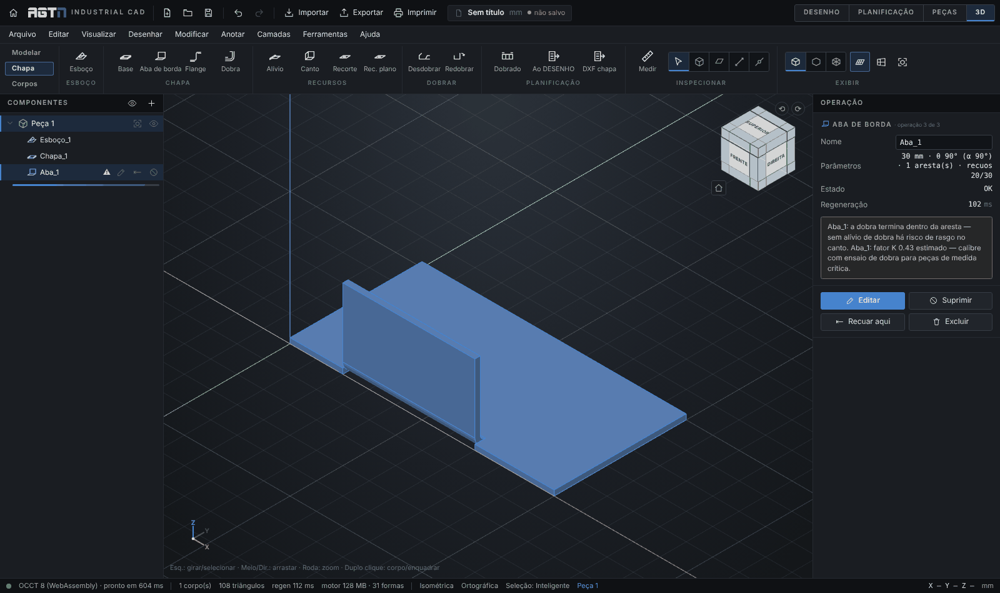 |
| Alívio retangular, dobrado | 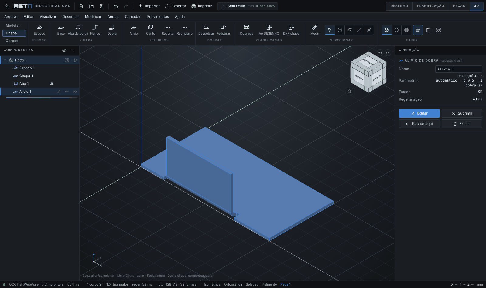 |
| Alívio retangular, planificado | 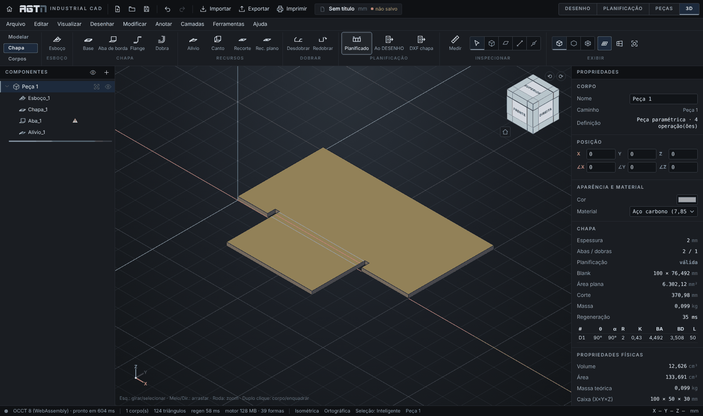 |
| Alívio oblongo, planificado |  |
| Aba de borda em 2 arestas, material por fora | 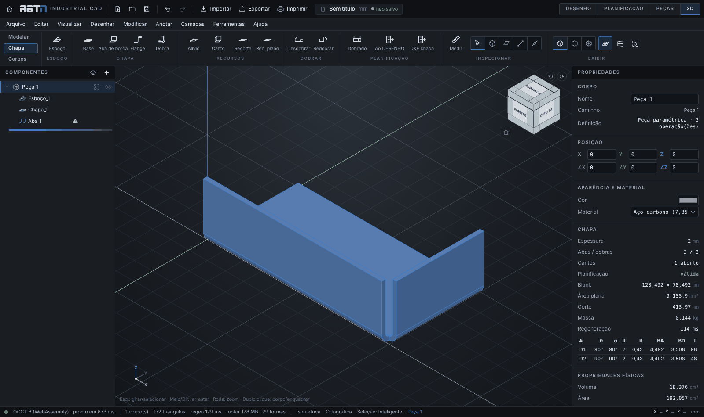 |
| … planificada (canto aberto) | 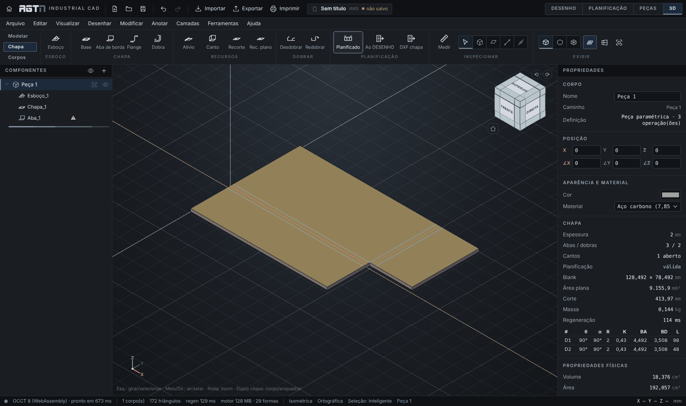 |
| Canto encosto, dobrado | 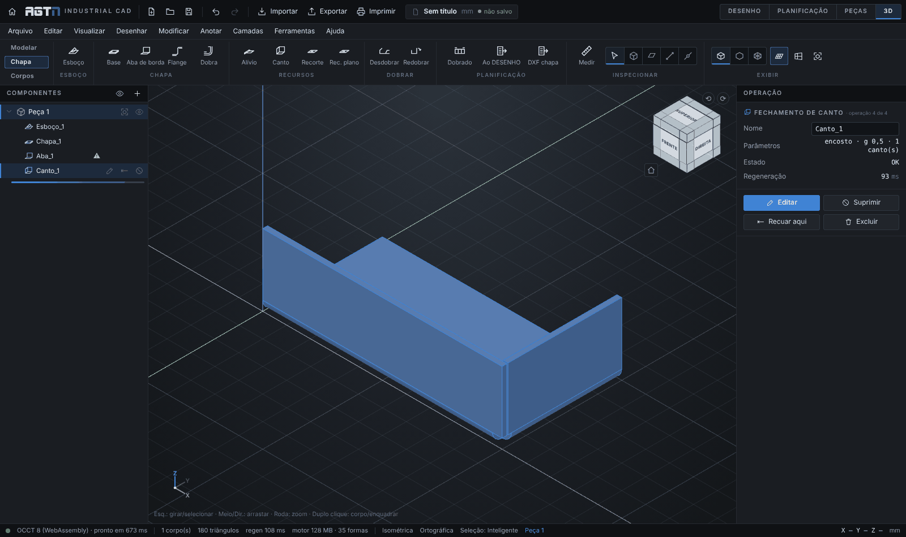 |
| Canto encosto, planificado | 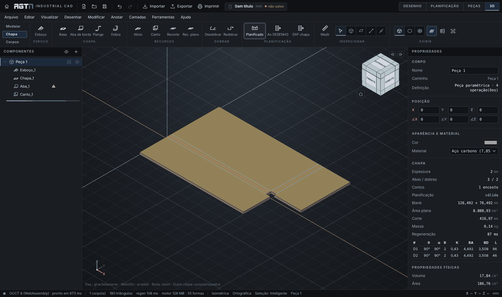 |
| Canto esquadria |  |
| Recorte atravessando a dobra, dobrado | 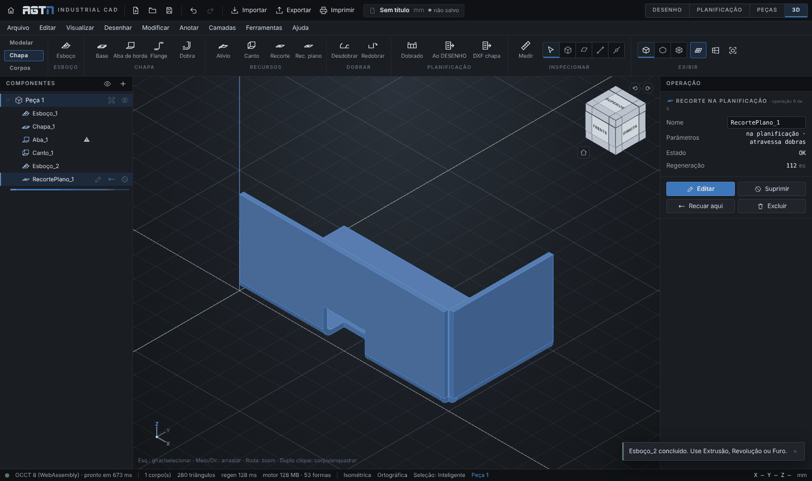 |
| … planificado | 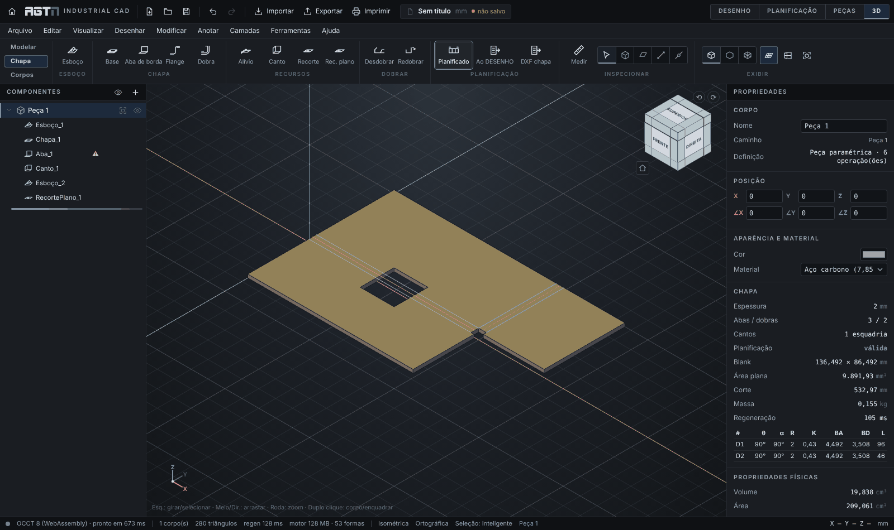 |
| Desdobrar tudo (histórico com Desdobrar_1) | 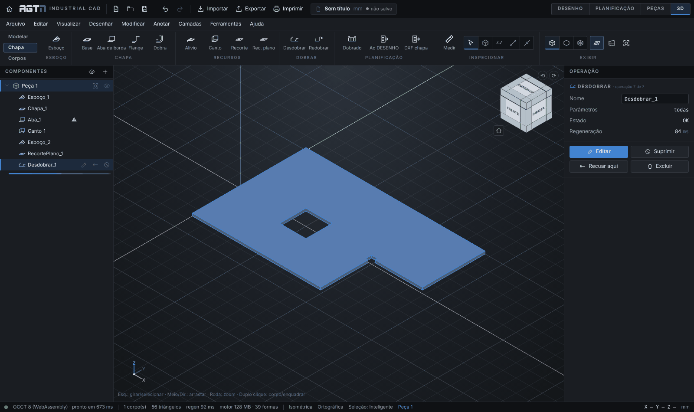 |
| Redobrado (histórico completo da peça) | 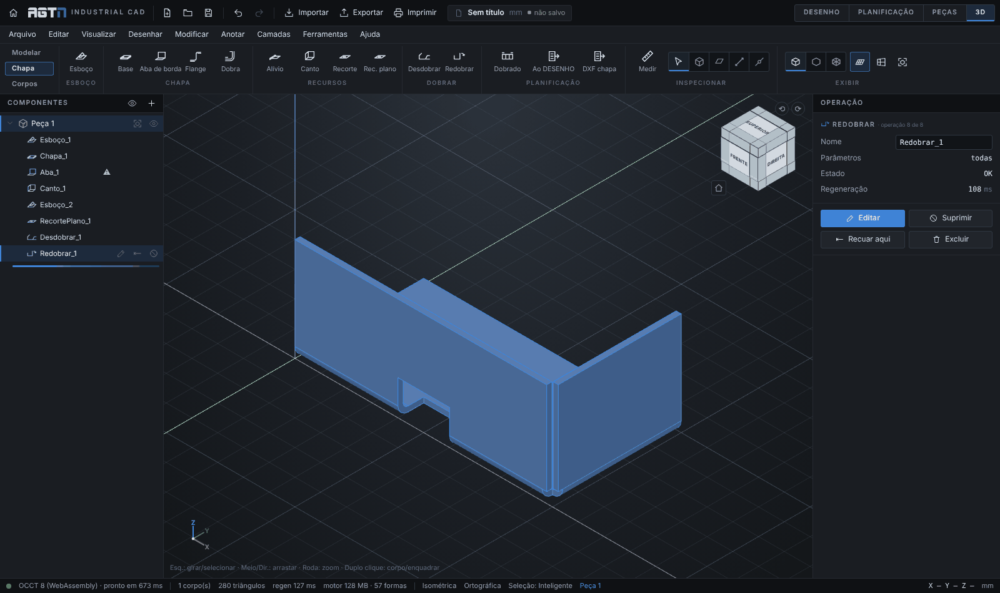 |
| Diálogo DXF com a conferência | 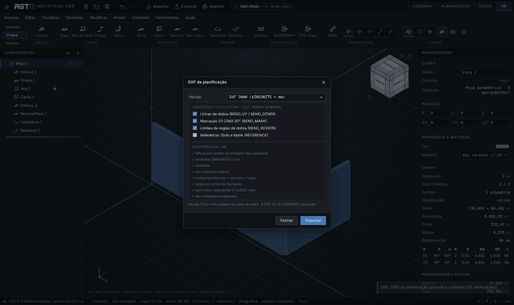 |
| DXF 2000 baixado do app, aberto no ezdxf | 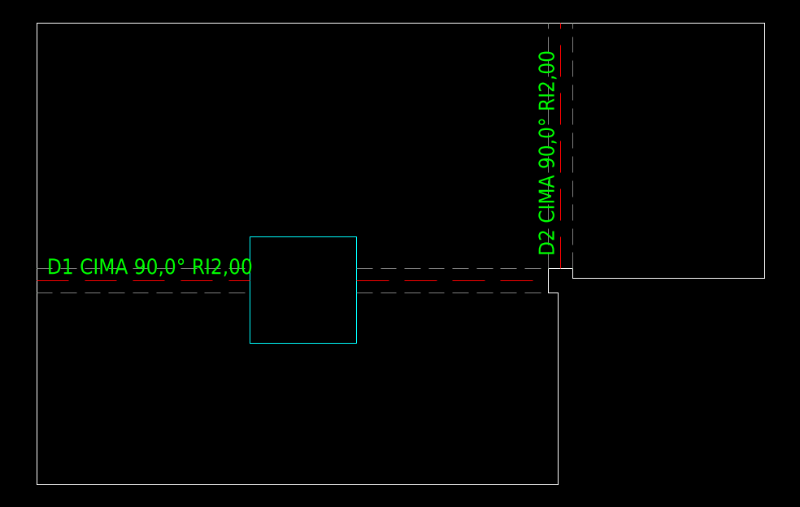 |
| DXF 2000: bandeja com cantos encosto | 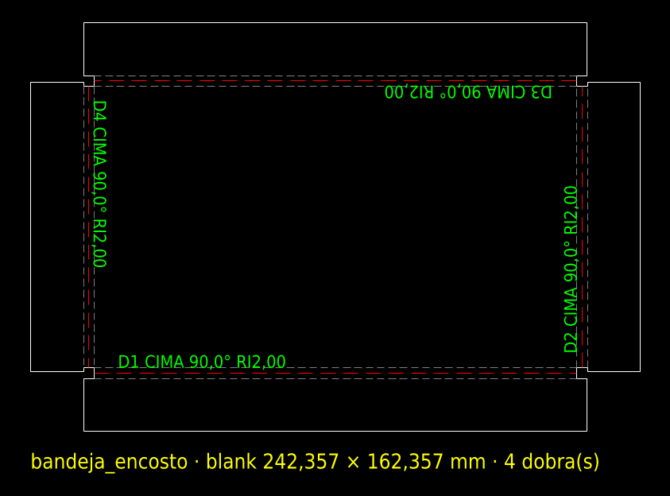 |
| DXF R12: alívios oblongos (bulges) | 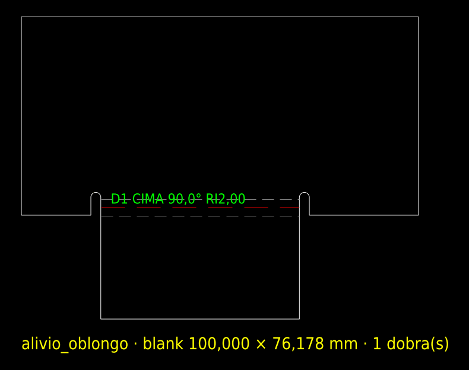 |
| App compilado: diálogo da base (caixas corrigidas) | 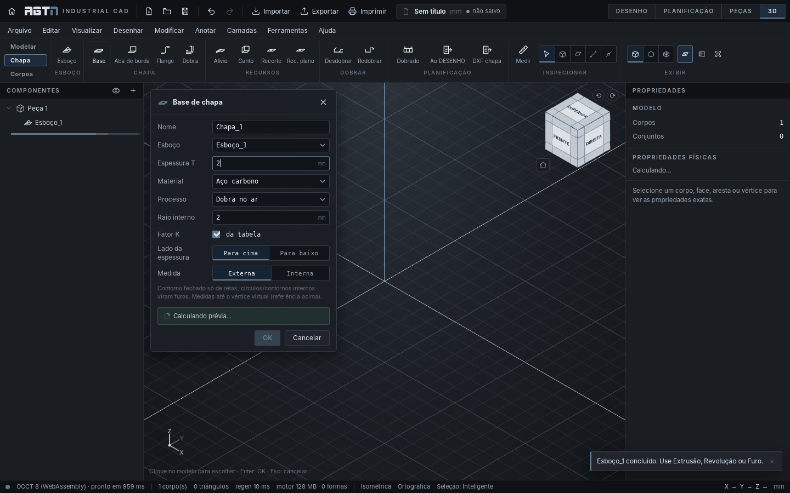 |
| App compilado: canto encosto | 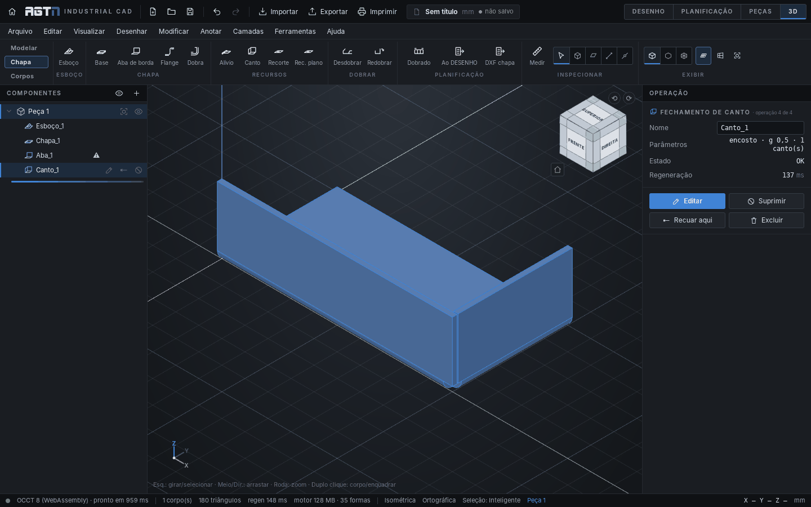 |

## 9. Compatibilidade de arquivos

- Formato `.agtncad` v1 mantido. Campos desconhecidos continuam preservados, como na ETAPA 1.
- Os campos novos são todos opcionais: `offsetStart`/`offsetEnd`, `position`, ids de segmento.
- As operações novas são `sheetRelief`, `sheetCorner`, `sheetFlatCut`, `sheetUnfold` e `sheetRefold`.
- **Arquivo gravado pela ETAPA 1** (código de `e463834`, rodando o e2e real):
  - abre idêntico;
  - regenera com 26 027,433388 mm³ e a planificação 129,477432 mm de quando foi gravado.
- Arquivo da ETAPA 2 (com canto, recorte plano e desdobrar/redobrar):
  - abre idêntico;
  - regenera igual;
  - salvar/reabrir passa no e2e.

## 10. Limitações e pendências

1. **Windows real: não testado.** Nenhum teste foi executado em Windows. Tudo acima é Linux: Chromium e Tauri
   com WebKitGTK.
2. **Alívio de canto redondo** e **círculo/arco cruzando a faixa** estão bloqueados, com erro claro. O núcleo
   atual não tem representação exata da parede curva na região dobrada, e a decisão foi não usar B-spline.
3. Recorte plano: o laço precisa ficar **dentro** do contorno da planificação. Entalhe na borda externa que
   cruza dobra: CUT2_EDGE. Laço que divide uma região ou deixa ilha: CUT2_SPLIT.
4. Fechamento de canto só entre **abas de borda irmãs** (mesma pai). Entre aba e flange de contorno, ou com
   pestanas: não suportado. Interferência continua detectada, por exemplo pestanas inteiras com cantos fechados.
5. Encosto e esquadria pedem folga > 0. Com 0 as abas se tocam e o sólido as fundiria; a solda não é modelada.
6. Aba inclinada em planta (leque) não tem parâmetro na operação, então não há o que bloquear. Fica para uma
   etapa futura.
7. Volume da região desdobrada: BA·L·T, pelo modelo do fator K. É uma propriedade do modelo, não um erro.
8. Desempenho foi medido só neste contêiner. Falta medir num PC Windows.
